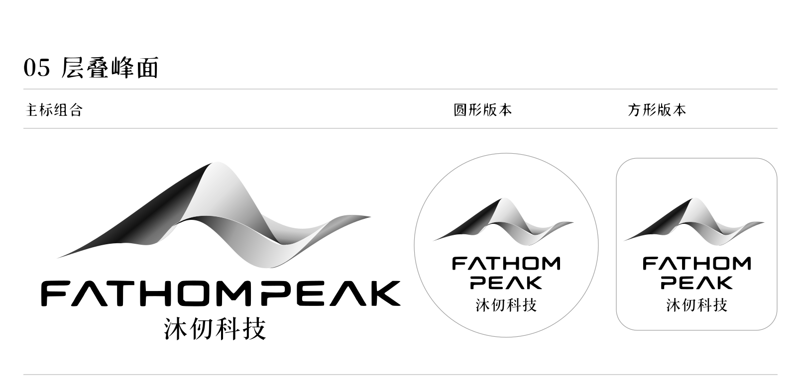

# FathomPeak 沐仞科技 · 中英字标统一版（2026-10-20）

- 英文：从用户图二直接提取几何科技字标矢量轮廓；禁止用普通无衬线字或衬线 FathomPeak 替代。
- 中文：按图二「沐仞」的宋楷笔形重整「沐仞科技」四字，统一粗细、字高、基线和字距。图二来自生成图稿，没有已确认的商业字体名称；本包提供定制字标轮廓，不冒称某款字体。
- logo 字标使用 SVG 或 PNG，不重新输入字体。正文与 UI 字体不受本次调整影响。
- 图形和黑白灰渐变沿用确认版；本轮调整字体，不改变已定图形配色。
- primary / circle / square / overview：主标、圆版、方版、总览；wechat-avatar-1024 为白底 1024 微信头像。
- wordmark-zh / wordmark-en：用于文档、公众号横幅的独立统一字标。
- 原 v30 及更早探索稿保留；现用材料应以 v31 为准。
- 原聊天：梳理项目进度 (2)，thread 01a12fd7-a4e7-7bc1-9f3d-5df1ad988234。
- 中文素材由内置 ImageGen 生成，按用户图二字形匹配后转曲。结构校验见 validation.json。

## 英文单行版本

- [PNG · 1024×1024](wechat-avatar-single-line-1024.png)
- [可编辑 SVG](wechat-avatar-single-line-1024.svg)

FATHOMPEAK 在同一行，保留现有山形与「沐仞科技」；两行版本仍保留。
