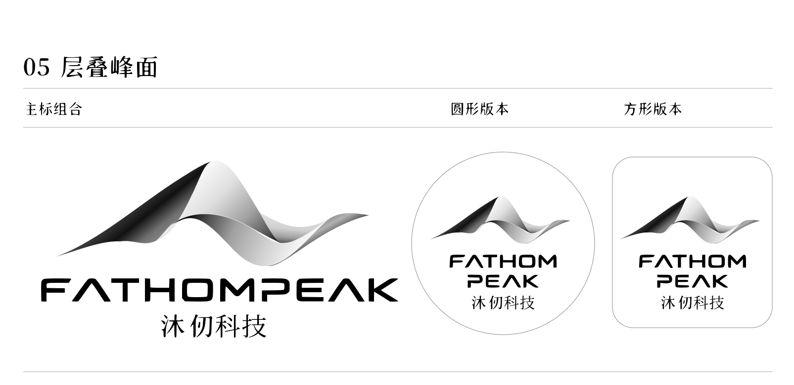

# FathomPeak 沐仞科技 · 黑白灰 Logo

2026-10-18 更新：仅保留已选定的科技英文 FATHOMPEAK 字标；中文扩展为“沐仞科技”。峰面路径、黑白灰渐变和英文轮廓沿用上一版。

## 下载

- [完整 SVG 文件包](fathompeak-logo-monochrome-20261018.zip)
- [总版 SVG](overview.svg)
- [主标 SVG（透明底）](primary.svg)
- [圆形 SVG](circle.svg)
- [方形 SVG](square.svg)
- [独立图形 SVG（透明底）](symbol.svg)

SVG 使用独立路径、渐变和分组，不含嵌入位图。字标已转曲，可编辑节点；不依赖外部字体，也不是可以直接键入的文字对象。圆形和方形的白底容器可以独立修改。

对应 PNG 是各个 SVG 的实际渲染预览。结构验证记录见 [validation.json](validation.json)。本次未更换官网现有 Logo。
