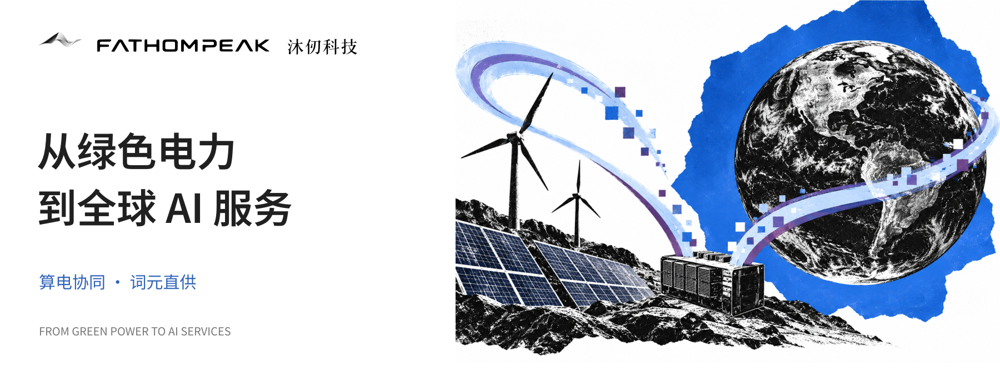
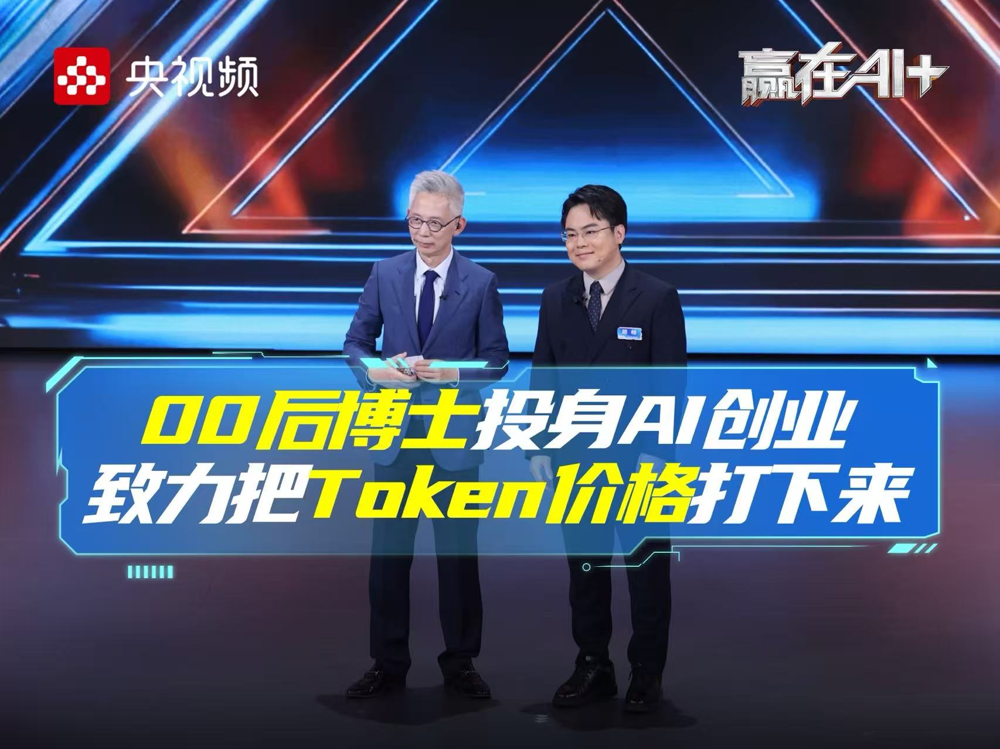
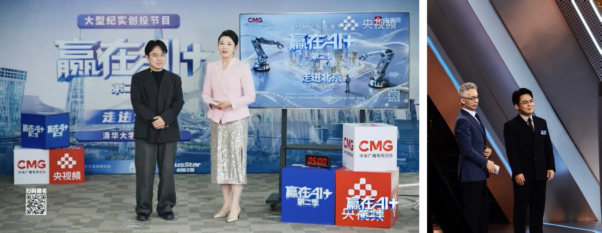
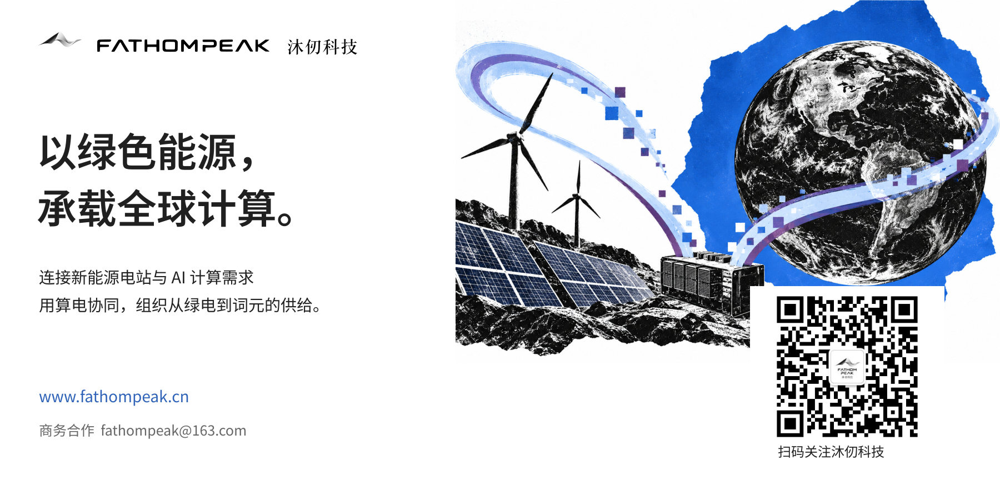

# 沐仞科技“词元出海”登顶央视《赢在AI+》单场最高分

近日，北京沐仞科技有限公司（以下简称“沐仞科技”）携“词元出海”项目亮相央视《赢在AI+》第二季“智效跃迁”专场。

在节目现场，沐仞科技围绕绿色能源与人工智能算力的协同发展，展示了“词元出海”的商业模式、技术路径与应用场景，介绍了如何将新能源电站的富余电力转化为可供全球AI企业使用的模型推理服务。

此次亮相不仅是沐仞科技向公众展示业务的一次机会，也让更多人了解到绿色能源与人工智能产业结合的新路径。

## 什么是“词元出海”？

人工智能的发展离不开算力，而算力的运行需要大量电力。

当前，随着风电、光伏等新能源装机规模持续增长，部分地区存在新能源消纳困难、发电能力与用电需求在时间和空间上不匹配等问题。与此同时，全球AI应用快速发展，模型推理需求不断增长，算力成本和服务供给成为企业关注的重要问题。

沐仞科技提出的“词元出海”，正是希望将这两方面的需求连接起来。

具体而言，沐仞科技通过在新能源电站及周边部署GPU算力设备，将当地具备成本优势的绿色电力用于AI模型推理，再通过统一的算力调度与服务平台，以API接口向国内外企业提供模型推理服务。

在这一过程中，电力不再只是通过电网输送到远方，也可以在当地转化为算力，并最终以Token（词元）的形式服务于全球AI应用。

对于海外客户而言，无须自行建设和维护算力基础设施，即可通过标准化API接口调用模型服务；对于能源企业而言，则可以探索将电力资源转化为高附加值数字服务的新路径。

简单来说，“词元出海”就是让绿色电力在当地转化为AI推理能力，再通过互联网向全球客户提供服务。

## 从能源到算力，解决实际产业需求

“词元出海”并非单纯的算力出口，而是围绕能源供给、算力基础设施和AI应用需求建立新的协同关系。

### 首先，是提高绿色能源的利用效率。

通过在新能源电站及周边部署算力设施，可以在具备条件的场景下就近使用绿色电力，探索缓解部分地区新能源消纳压力的方式。

### 其次，是降低AI推理服务的成本。

电力成本是算力基础设施运营的重要组成部分。沐仞科技希望通过能源侧的成本优势，结合分布式算力调度技术，提高算力资源利用效率，为客户提供具有成本竞争力的模型推理服务。

### 再次，是降低企业使用AI模型的门槛。

通过统一的服务平台，客户可以按照实际需求调用模型，无须直接管理底层GPU设备。平台负责算力资源调度、推理任务分配及服务交付，让企业能够更加便捷地使用AI能力。

此外，沐仞科技也在探索绿色算力服务的相关管理与信息披露机制，为客户了解算力服务的能源来源和绿色属性提供支持。

从绿色电力到GPU算力，再到模型推理服务，“词元出海”希望打通能源供给与AI应用之间的关键环节。

## 亮相《赢在AI+》，展示算电协同的商业价值

《赢在AI+》是由中央广播电视总台与杭州市人民政府联合打造的大型纪实创投节目。第二季第六期聚焦“智效跃迁”，展示 AI 在不同产业场景中的实践。

在本次节目中，沐仞科技围绕“词元出海”项目，重点展示了算电协同的商业模式，以及绿色能源如何通过算力基础设施转化为可交付的AI服务。

与传统的集中式算力建设模式相比，沐仞科技选择从能源侧切入，在具备电力资源优势的地区建设分布式算力节点，并通过统一平台实现算力调度与服务交付。

这一模式将能源企业、算力基础设施和AI应用客户连接起来，为绿色电力的利用和AI推理服务的供给提供了新的思路。

此次节目成绩，是对沐仞科技项目展示与商业构想的一次积极反馈，也为公司进一步拓展产业合作提供了展示机会。

## 从节目舞台走向实际应用

对于沐仞科技而言，节目展示只是业务发展过程中的一个阶段。如何将算电协同的技术路径转化为稳定、可持续的商业服务，仍然是公司下一阶段工作的重点。

目前，沐仞科技正围绕分布式算力基础设施建设、统一算力调度平台研发和AI推理服务交付持续推进业务。

在能源侧，公司积极与新能源发电企业及相关产业伙伴开展合作，探索不同能源场景下的算力节点部署与运营模式。

在技术侧，公司持续完善算力调度平台，围绕电价、网络时延、节点负载和运行状态等因素优化资源分配，提高分布式算力网络的运行效率。

在应用侧，公司面向国内外AI企业及开发者，推进模型推理服务测试与商业化交付，探索更加灵活、经济的Token服务模式。

未来，沐仞科技将继续加强与能源企业、算力设备厂商、模型服务商及AI应用企业的合作，推动绿色能源与人工智能产业的协同发展。

## 让绿色电力服务更多AI应用

此次亮相央视《赢在AI+》，让沐仞科技的“词元出海”项目获得了更多关注。

对公司而言，节目成绩既是一份认可，也意味着新的期待。

沐仞科技将继续围绕算电协同基础设施建设、词元直供平台研发和全球AI推理服务拓展，推进产品完善与业务落地。

我们期待与更多能源企业、AI应用客户及产业合作伙伴开展交流与合作，共同探索绿色算力的应用空间。

让绿色电力转化为可用的AI算力，让中国绿色算力服务更多全球AI应用。

---

## 节目与更多信息

相关报道：https://feng.ifeng.com/c/8wherrY97sl

播出信息：2026 年 9 月 25 日 · 第二季第六期；央视频 16:30 / CCTV-2 22:00（据节目预告）

官方网址：https://www.fathompeak.cn/

商务合作：fathompeak@163.com

微信咨询：扫码关注「沐仞科技」公众号

人才招聘：https://xanthiawang.github.io/fathompeak-ui-kit/recruitment/

