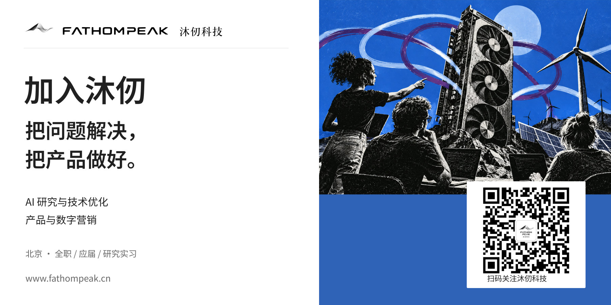

# 沐仞科技招聘｜AI技术、产品与海外市场岗位开放

我们正在招聘产品营销与AI技术人才，欢迎有经验的专业人士、应届毕业生及优秀研究实习生加入。

人工智能正在快速发展，大模型推理需求持续增长，算力成本、能源供给和服务效率成为行业面临的重要问题。

与此同时，风电、光伏等新能源的装机规模不断扩大，部分地区仍然存在绿色电力消纳困难、能源利用效率有待提升等问题。

能否让绿色电力就近转化为AI算力？能否通过更高效的调度和推理优化，降低AI服务成本？能否让全球客户更加便捷地使用绿色算力？

这些是沐仞科技正在探索和解决的问题。

现在，我们希望找到更多愿意解决实际问题的伙伴，一起把技术转化为产品，把产品推向市场。

## 01 关于沐仞科技

北京沐仞科技有限公司（FathomPeak）成立于2026年，是一家专注于AI基础设施与分布式算力网络建设的科技企业。

我们致力于推动绿色能源与人工智能算力的协同发展，通过在新能源电站及周边部署GPU算力设备，将绿色电力转化为可供企业和开发者使用的AI推理服务。

目前，公司围绕以下方向开展业务：

算电协同基础设施： 在具备能源优势的地区建设和运营分布式算力节点，探索绿色电力就近转化为算力的模式。

统一算力调度平台： 综合考虑电价、网络时延、GPU负载及节点运行状态，实现分布式算力资源的管理与任务调度。

词元直供与模型API服务： 通过标准化API接口向国内外客户提供模型推理服务，降低企业使用AI模型的成本与技术门槛。

词元一体机： 探索集成GPU计算、模型推理及远程管理能力的算力设备与部署方案，满足不同场景下的算力需求。

我们的目标，是建立连接绿色能源、算力基础设施与AI应用的服务网络，让算力资源得到更加高效的利用。

## 02 招聘岗位

本次招聘主要面向产品与数字营销、AI研究与技术优化两个方向，共开放四类岗位。

### 岗位一：产品与数字营销运营

工作地点： 北京

岗位类型： 全职

#### 岗位职责

1. 参与公司AI推理服务、词元直供平台等产品的市场定位、产品介绍及推广策略制定。
1. 负责公司官网、产品介绍、技术文档及相关内容的建设与维护，提升产品信息的准确性和可读性。
1. 面向海外市场开展英文内容运营，包括LinkedIn等社交媒体平台的内容策划、发布与推广。
1. 配合业务团队开展潜在客户开发、市场活动及客户转化工作，优化客户从了解产品到实际使用的流程。
1. 跟踪网站流量、用户行为、内容传播及客户转化等数据，分析推广效果并持续优化运营策略。
1. 与技术、产品及商务团队协作，将复杂的技术能力转化为客户能够理解的产品价值。
#### 任职要求

1. 本科及以上学历，市场营销、计算机、商科、传播学等相关专业优先。
1. 具备科技产品、AI服务、SaaS或海外市场相关工作经验者优先。
1. 具备良好的中英文表达能力，能够独立撰写清晰、准确的英文产品及营销内容。
1. 熟悉海外数字营销渠道，对SEO、内容营销、社交媒体运营或用户增长有一定了解。
1. 具备数据分析意识，能够根据实际效果调整推广策略。
1. 对人工智能及技术产品有兴趣，愿意主动理解产品原理和客户需求。
### 岗位二：产品与数字营销运营（初级）

工作地点： 北京

岗位类型： 全职，接受优秀应届毕业生

#### 岗位职责

1. 协助完成公司官网、产品介绍、英文文档及宣传材料的制作与更新。
1. 参与LinkedIn等海外社交媒体平台的日常运营与内容发布。
1. 协助开展市场调研、竞品分析、客户信息整理及推广活动。
1. 跟踪和整理网站、社交媒体及客户转化数据，形成基础分析报告。
1. 配合产品与商务团队完成客户沟通、产品演示材料及其他运营工作。
#### 任职要求

1. 本科及以上学历，专业不限，对AI、科技产品或海外市场有浓厚兴趣。
1. 具备良好的英文阅读和写作能力，能够完成基本的英文内容编辑工作。
1. 具备较强的信息检索、文字表达和沟通协调能力。
1. 熟悉常用办公软件，愿意学习数字营销、数据分析及AI相关工具。
1. 做事认真负责，学习能力强，能够主动推进工作。
有相关项目、实习或个人作品经验者优先。

我们欢迎优秀应届毕业生申请，不要求候选人已经具备完整的AI行业工作经验，但希望你愿意学习、善于沟通，并能够把具体工作做好。

### 岗位三：AI研究与技术优化负责人

工作地点： 北京

岗位类型： 全职

#### 岗位职责

1. 负责公司AI推理服务的技术优化与研究工作，制定推理性能、资源利用率及成本优化方案。
1. 研究和优化不同GPU硬件环境下的大模型推理性能，提升异构算力资源的使用效率。
1. 基于vLLM、SGLang等推理框架，开展推理部署、性能测试、系统调优及相关技术研发。
1. 建立模型推理性能评测体系，围绕吞吐量、首Token延迟、响应延迟、资源利用率等指标开展分析与优化。
1. 研究多模型、多节点环境下的推理任务路由与调度策略，提高分布式算力平台的运行效率。
1. 结合GPU能耗、电价及电站运行数据，研究算力任务与能源供给之间的协同优化方法。
1. 与平台研发、基础设施及业务团队协作，推动研究成果在实际产品和客户场景中落地。
1. 负责相关技术方向的研究规划、技术方案设计及团队协作。
#### 任职要求

1. 计算机科学、人工智能、软件工程等相关专业本科及以上学历。
1. 具备大模型推理部署、性能优化或分布式计算系统相关经验。
1. 熟悉Python、C++等编程语言，具备扎实的软件工程及系统性能分析能力。
1. 熟悉vLLM、SGLang等主流大模型推理框架，理解推理服务的关键性能指标与优化方法。
1. 对GPU架构、显存管理、并行计算、推理调度或异构计算有较深入的理解。
1. 具备独立分析复杂技术问题、制定解决方案并推动落地的能力。
1. 具有良好的技术沟通与跨团队协作能力。
具有大规模推理服务、GPU性能优化、分布式调度或相关开源项目经验者优先。

### 岗位四：AI研究与技术优化工程师（初级）

工作地点： 北京

岗位类型： 全职，接受优秀应届毕业生

研究实习生： 可申请，具体安排另行沟通

#### 岗位职责

1. 参与大模型推理服务的部署、测试及性能优化工作。
1. 基于vLLM、SGLang等框架开展模型推理实验，分析不同配置下的性能表现。
1. 协助建立和维护模型评测工具，收集吞吐量、延迟、GPU利用率等关键指标。
1. 参与异构GPU环境下的推理性能测试与问题排查。
1. 协助开展模型路由、任务调度及资源分配策略的研究与实验。
1. 参与GPU能耗、电价及电站运行数据的整理分析，探索能源与算力协同优化的技术方案。
1. 编写实验记录、技术文档及测试报告，协助推动技术成果应用于实际产品。
#### 任职要求

1. 计算机科学、人工智能、软件工程、数学等相关专业本科及以上学历。
1. 具备良好的Python编程能力，熟悉Linux开发环境。
1. 了解机器学习、深度学习及大语言模型的基本原理。
1. 对模型推理、GPU计算、分布式系统或性能优化有兴趣。
1. 具备良好的实验习惯，能够独立开展基础测试、分析数据并总结结果。
1. 学习能力强，愿意阅读技术文档、研究开源项目并解决实际问题。
具有PyTorch、vLLM、SGLang、CUDA或相关项目经验者优先。

欢迎优秀应届毕业生及相关方向的在校研究生申请。对于研究实习生，我们更加关注实际技术能力、研究兴趣和学习潜力。

## 03 为什么加入沐仞科技？

#### 接触真实的产业问题

我们关注的不只是模型性能本身，还包括GPU设备、能源成本、算力调度、客户需求和商业交付等实际问题。

在这里，技术研发与产品运营都直接面向真实业务场景。

#### 参与技术与业务的交叉创新

算电协同涉及人工智能、分布式计算、能源系统及国际市场等多个领域。

无论是优化推理性能，还是向海外客户介绍产品，都需要理解技术如何创造实际价值。

#### 有机会参与产品从建设到落地的全过程

作为一家处于发展早期的科技企业，沐仞科技正在持续完善产品和业务体系。

加入团队的成员将有机会参与具体产品的建设、优化和市场推广，直接了解技术方案如何转化为可交付的服务。

#### 重视实际能力与工作成果

我们希望找到能够独立思考、主动解决问题、重视实验与数据，并愿意与不同专业背景的同事协作的人。

无论你已经拥有丰富的行业经验，还是刚刚走出校园，只要具备与岗位相匹配的能力和学习意愿，我们都欢迎你投递简历。

## 04 如何申请？

#### 招聘岗位

- 产品与数字营销运营
- 产品与数字营销运营（初级）
- AI研究与技术优化负责人
- AI研究与技术优化工程师（初级）
工作地点： 北京市海淀区

邮件标题格式： 应聘岗位－姓名－学校/现任公司

#### 建议提交材料：

个人简历，以及能够展示相关能力的项目经历、作品集、GitHub链接、技术报告或其他补充材料。

研究实习生请在邮件中注明研究方向、预计实习时间及每周可到岗天数。

我们将根据岗位要求进行简历筛选，并与合适的候选人联系后续安排。应聘材料仅用于本次招聘及相关沟通，并按照适用的个人信息保护要求进行处理。

## 05 期待与你同行

从绿色电力到GPU算力，从模型推理到Token服务，沐仞科技正在尝试连接能源与人工智能产业的不同环节。

这项工作需要技术研发，也需要产品建设、市场运营和客户服务。

如果你对人工智能基础设施充满兴趣，希望参与真实产品的研发与落地，欢迎加入沐仞科技。

栉风沐雨，登高万仞。我们期待与你一起，把问题解决，把产品做好。

---

官方网址：https://www.fathompeak.cn/

微信咨询：扫码关注下方「沐仞科技」公众号。

