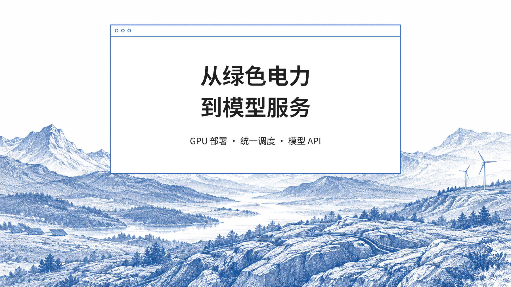
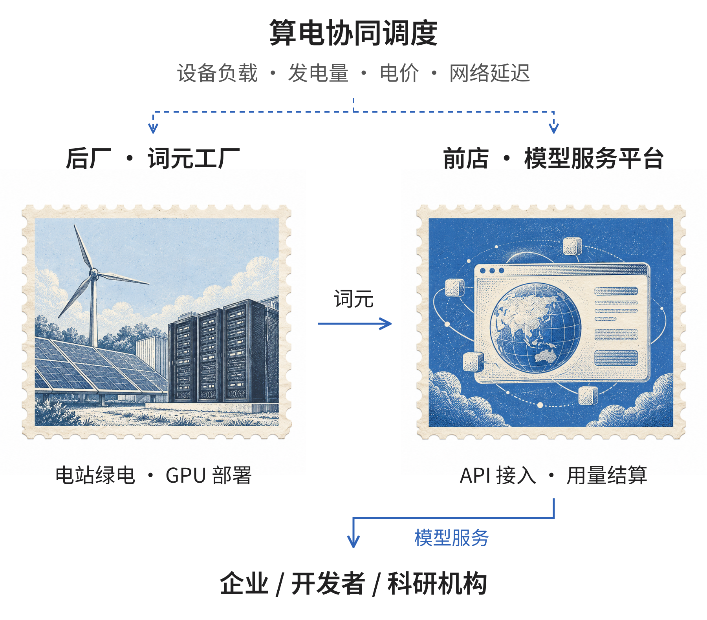

# 沐仞科技｜绿色算力部署与模型 API 服务，开放合作

沐仞科技（FathomPeak），全称北京沐仞科技有限公司，成立于2026年，总部位于北京，是一家专注于AI基础设施、算电协同与分布式算力网络的科技企业。

公司致力于将人工智能基础设施与新能源基础设施相结合，通过异构算力调度、能源协同优化和分布式通信技术，构建面向全球的分布式AI算力网络。

为企业、开发者和科研机构提供高效、可靠、具有成本竞争力的模型推理服务。

公司提出“前店后厂”的业务模式：在能源侧建设词元工厂，通过统一调度平台组织计算资源，并面向客户提供模型API接入与词元交易服务。

我们的目标是让计算任务与能源条件更高效地匹配，推动绿色能源与人工智能产业的协同发展。

## 一、核心业务

沐仞科技围绕AI基础设施建设、算电协同调度和模型推理服务，开展三项核心业务。

### 1. 词元工厂：能源侧算力基础设施建设与运营

公司面向光伏、风电等新能源场景，提供GPU计算设备部署、算力节点建设及技术运营服务。

根据不同电站的现场条件，提供风冷一体机、塔式液冷一体机和可移动集装箱等部署方案，综合考虑供电条件、散热环境、网络接入及设备维护要求。

在合作模式上，公司可与能源企业、设备投资方及基础设施资产方共同建设算力节点。

由合作方投资相关设备，沐仞科技提供技术部署、运营管理与算力服务支持，并根据合作协议分享运营收益。

通过在能源侧部署计算资源，公司希望提高部分新能源资源的利用效率，为AI推理服务提供更具成本竞争力的基础设施。

### 2. 算电协同调度：统一管理分布式计算与能源资源

算电协同调度是公司的核心技术方向。

公司通过统一调度系统，将GPU负载、设备性能、发电量、电价及网络延迟等因素共同纳入任务分配过程，实现计算资源与能源条件的动态匹配。

围绕这一目标，公司开展异构GPU协同、分布式通信、模型执行优化和能源预测等技术研发。

主要技术模块包括：

#### Tapestrix：异构算力执行与优化系统

面向不同型号、不同性能的GPU设备，开展模型与计算资源之间的动态映射和任务执行优化，支持多卡、多机及异构计算环境下的资源协同。

#### NetWeaver：分布式网络通信与调度系统

将网络延迟、传输条件与计算任务要求共同纳入调度，优化跨节点任务执行与结果交付。

#### 算电协同调度系统

结合算力集群管理、电力资源管理及协同调度机制，综合考虑GPU能耗、计算负载、发电量、电价和网络条件，优化计算任务在不同节点之间的分配。

通过上述技术，公司致力于将分散的计算设备与能源资源组织成可统一管理、动态调度的分布式算力网络。

### 3. 词元交易平台：面向企业与开发者的AI推理服务

公司建设面向企业、开发者和科研机构的词元交易平台，提供模型API接入、服务管理、用量统计与费用结算等功能。

平台以Token（词元）为主要服务计量单位，将后端计算资源组织为可持续采购的模型服务。

主要应用场景包括：

- AI for Science： 面向科研计算与人工智能辅助科研需求，提供模型推理服务。

- 企业AI应用： 支持企业文档处理、内容生成、信息分析等业务。

- 内容审核： 面向社交平台、跨境电商等场景，提供文本及多模态内容处理服务。

- 模型API服务： 面向开发者及企业客户，提供模型调用与相关技术支持。

公司通过统一服务入口连接客户需求与分布式计算资源，逐步形成从能源侧算力部署到模型服务交付的完整业务体系。

## 二、技术优势

沐仞科技的技术研发主要围绕三个方向展开。

#### 第一，算电协同优化。

将能源条件引入传统算力调度体系，综合考虑发电量、电价、设备能耗和计算负载，在满足业务要求的前提下优化资源分配。

#### 第二，异构算力协同。

针对不同型号GPU及多机、多卡计算环境，开展模型执行优化与动态资源调度，提高异构计算资源的利用效率。

#### 第三，分布式通信与服务交付。

围绕跨区域计算节点的网络延迟、数据传输和任务执行要求，研究分布式通信与调度技术，支持不同节点之间的协同运行。

团队在电碳算协同、计算机体系结构、并行执行和资源分配等领域具有研究积累，相关研究成果已发表于计算机体系结构等领域的学术会议。

## 三、项目进展与业务布局

目前，沐仞科技正在光伏、海上风电等新能源场景推进算电协同试点，并围绕分布式GPU部署、统一调度及模型推理服务开展项目合作。

在能源侧，公司与相关能源企业、基础设施资产方及产业合作伙伴推进算力节点建设与运营方案。

在计算侧，公司持续开展异构GPU部署、模型执行优化及分布式调度技术研发。

在客户侧，公司面向AI for Science、社交平台、跨境电商内容审核等应用场景，推进模型推理服务的测试与商业合作。

公司正在逐步建立覆盖能源侧算力部署、技术运营、任务调度及模型服务交付的业务体系。

## 四、创始团队

沐仞科技团队成员具有清华大学、北京大学、武汉大学及麻省理工学院等高校的教育与研究背景，专业领域覆盖电气工程、计算机科学、人工智能、能源经济与金融。

团队同时拥有AI基础设施企业、互联网科技公司、能源投资及国际金融机构的工作经验。

### 创始人：路畅

路畅本科毕业于武汉大学，后进入清华大学攻读工学博士，研究方向涉及算电协同调度及相关优化技术。

在产业实践方面，路畅具有AI基础设施企业COO任职经历，以及分布式光伏投资经验，熟悉算力基础设施运营、能源项目投资与相关产业流程。

此外，路畅曾入选清华大学与麻省理工学院（MIT）Energy Ventures交换项目，并入选中国AI U25创业者榜单。

### 技术团队

公司技术团队由具有清华大学、北京大学相关学科背景的成员组成。

其中：

- 电力与能源方向： 团队成员具有清华大学电气工程背景，研究领域包括电碳算协同、能源系统优化及算电一体化。

- 计算机体系结构方向： 团队成员具有清华大学计算机科学背景，研究领域包括并行执行、异构计算与资源分配，相关成果发表于计算机体系结构等领域的学术会议。

- 人工智能与算法方向： 团队成员具有北京大学计算机及人工智能背景，并拥有快手、字节跳动等互联网企业的算法研发工作经验。

### 商业与国际市场团队

公司商业与国际市场成员具有清华大学经济金融、麻省理工学院经济学硕士及宾夕法尼亚大学沃顿商学院交换学习背景，并拥有北美量化投资机构等相关工作经历。

团队围绕能源项目合作、基础设施投资、企业客户拓展及国际市场开展业务。

## 五、荣誉与成果

公司及团队在技术研发、创新创业和产业实践方面取得了以下阶段性成果。

### 创新创业赛事

- 央视《赢在AI+》“智效跃迁”赛道第一名

- 北京卫视《转在北京》“智算纵横”赛道第一名

- “挑战杯”清华大学赛事亚军

- 中国国际大学生创新大赛清华大学赛事十强

### 团队荣誉

- 创始人路畅入选中国AI U25创业者榜单

- 创始人入选清华大学与MIT Energy Ventures交换项目

### 学术研究

- 团队成员在计算机体系结构、并行执行、资源分配等领域开展相关研究

- 相关研究成果发表于计算机体系结构等领域的学术会议

### 媒体关注

- 中央电视台相关节目报道

- 北京卫视相关节目报道

- 《浦江科技评论》相关内容刊载

上述成果为公司的技术研发、项目合作与产业化探索提供了支持。

## 六、合作方向

沐仞科技面向能源企业、算力设备合作伙伴、AI应用企业、科研机构及产业投资方开展合作。

### 能源与电站合作

面向光伏、风电及其他具备合适条件的能源场景，合作建设分布式GPU算力节点，探索能源与计算资源的协同运营。

### 算力设备与基础设施合作

面向GPU设备供应商、基础设施资产方及相关产业伙伴，开展设备部署、技术运营与算力资源协同合作。

### 模型服务与企业客户合作

面向具有持续模型推理需求的企业、开发者和科研机构，提供模型API接入、推理服务及相关技术支持。

### 技术研发与产业合作

围绕算电协同调度、异构GPU计算、分布式通信、能源预测与AI基础设施运营等方向，与高校、科研机构及产业伙伴开展交流合作。

## 七、联系我们

公司名称： 北京沐仞科技有限公司

英文品牌： FathomPeak

成立时间： 2026年

总部： 北京市海淀区

核心业务： AI基础设施、算电协同调度、分布式算力网络、模型推理服务

合作咨询： fathompeak@163.com

官方网站： www.fathompeak.cn

微信公众号： 沐仞科技

沐仞科技 FathomPeak

让计算与能源更高效地协同，为AI应用提供可靠、可持续的基础设施服务。

