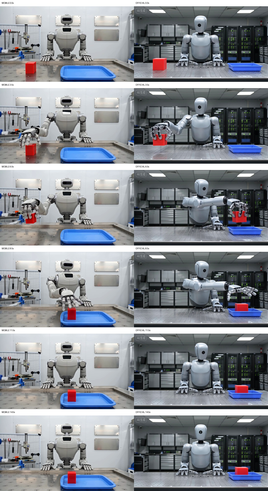
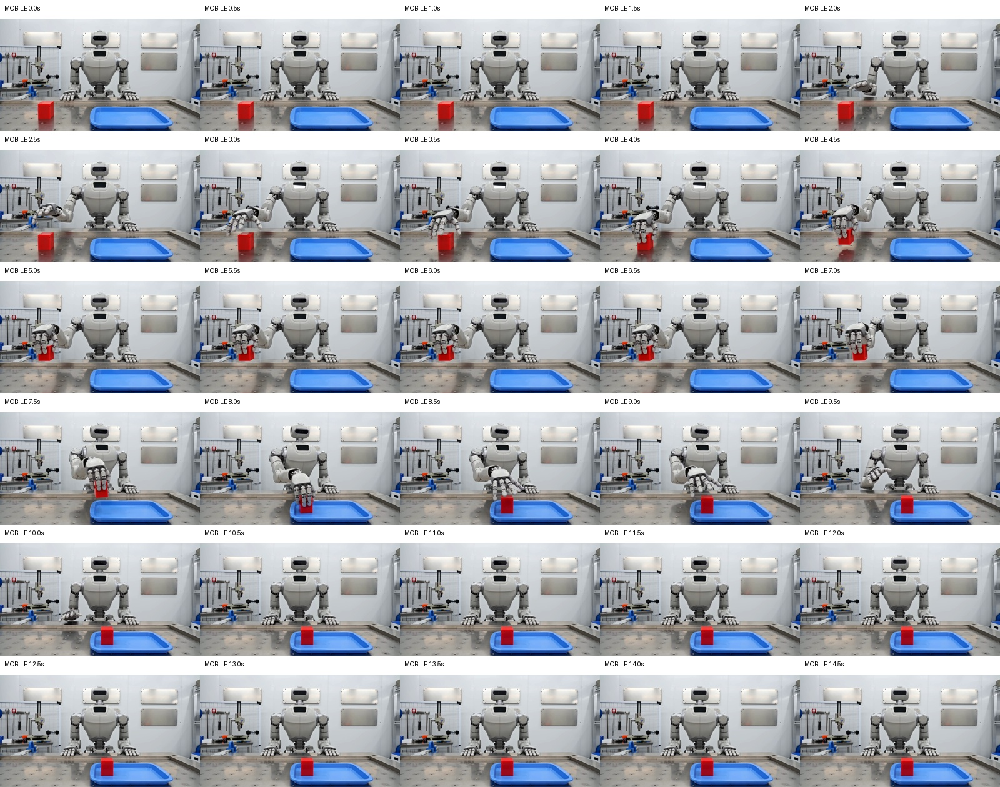
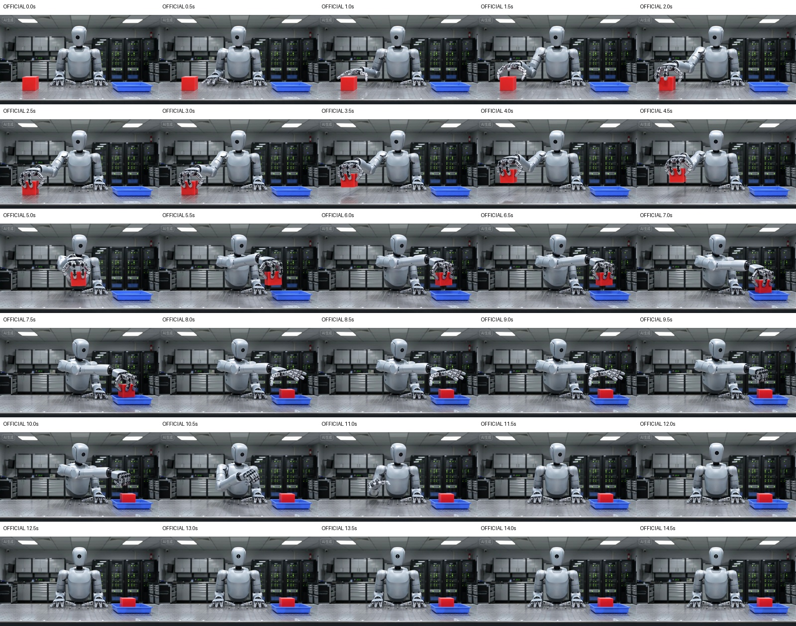

[← 返回沐仞项目与素材](../../)

## 先看结果

现在有**两个不同的prompt、四条真实原片**。每组内部，移动侧与官方使用逐字相同的prompt及相同标称参数；组与组之间的任务内容不同。

| 测试组 | 移动侧首次观察成功 | 官方首次观察成功 | 本组结果 |
|---|---|---|---|
| 5秒：机器人挥手 | 164.69秒，约2分45秒 | 411.38秒，约6分51秒 | 两边完成主要动作，官方落桌更明确；本次移动等待较短 |
| 15秒：搬运方块 | 434.28秒，约7分14秒 | 389.77秒，约6分30秒 | 两边完成主序列与尾段台词；本次官方先被观察到完成 |

**15秒组两边都做到了拿起方块、放入托盘、松手和右手回桌，未见明显主体漂移；共同偏差是提前起手，没有严格遵守0–3秒静止。** 两组的等待先后顺序相反，不能据此给出统一的渠道速度排名。

下述分钟数均为“提交到首次观察成功”的等待时间，包含排队和观察延迟；纯推理时间均未取得。每个prompt每个渠道各1条，不是稳定性或总体质量基准。

## 新增15秒组：搬运方块

这一组是全新的prompt，不是把5秒挥手视频重复生成。两边均为Seedance 2.0标准版、720p、16:9、15秒、无参考素材、各1条。提交相隔 **17.54秒**，未控制相同随机种子。

### 时间与实际费用

| 记录 | 移动供应商 | 即梦官方 |
|---|---|---|
| 提交时间（2026-10-25，北京时间） | 15:54:19.259 | 15:54:36.801 |
| 首次观察成功（北京时间） | 16:01:33.541 | 16:01:06.570 |
| **提交至首次观察成功** | **434.28秒，约7分14秒** | **389.77秒，约6分30秒** |
| 最后一次观察未完成（相对提交） | 428.06秒 | 290.69秒 |
| 实际成片与解码 | 1280×720，约15.07秒，361帧，通过 | 1280×720，约15.07秒，361帧，通过 |
| 本次实际费用 | 控制台显示$14.9454，结算币种未核实 | 210即梦积分 |
| 新增生成次数 | 1 | 1 |

本次官方的首次成功观测等待比移动侧少 **44.51秒**。移动侧实际完成被界定在提交后 **(428.06, 434.28]秒**，官方被界定在 **(290.69, 389.77]秒**；官方观察间隔较宽，不能把首次观测时间当作准确的后台完成时刻。

移动接口约1.50秒返回任务ID，后台任务创建至更新时间差为428秒。供应商控制台另报服务耗时436.21秒，口径与客户端轮询记录不同，以上均不等于纯推理耗时。

**出片和下载分开记录：** 移动侧成功后，自动下载原片另耗时 **123.77秒**；从提交到文件完整落地为 **558.05秒，约9分18秒**。这是本次网络下载记录。官方经过人工式页面导航后下载，没有取得同口径的自动下载耗时，因此不对两边下载速度作排名。

本次移动费用低于授权的20个显示余额单位，官方按授权210积分执行。计费单位不同，不横比价格。API轮询期间遇到1次HTTP 502，后续查询恢复；没有重新提交生成任务。

[下载15秒组计时、费用与媒体哈希](data/t05-long-video-20261025.json)

### 两条15秒原片

移动供应商：

<video controls playsinline preload="metadata" style="width:100%;max-width:800px" src="media/mobile-seedance2-15s-20261025.mp4"></video>

[下载移动15秒原片](media/mobile-seedance2-15s-20261025.mp4){download="mobile-seedance2-15s-20261025.mp4"}

即梦官方：

<video controls playsinline preload="metadata" style="width:100%;max-width:800px" src="media/official-seedance2-15s-20261025.mp4"></video>

[下载官方15秒原片](media/official-seedance2-15s-20261025.mp4){download="official-seedance2-15s-20261025.mp4"}

### 动作、连续性和台词

| 检查项 | 移动侧 | 官方 |
|---|---|---|
| 拿起→移入托盘→松手→手回桌 | 主序列可见 | 主序列可见 |
| 机器人、红方块、蓝托盘 | 抽帧中可辨识，未见明显复制、消失或切镜 | 抽帧中可辨识，未见明显复制、消失或切镜 |
| 0–3秒双手平放 | 未严格遵守，2.0秒抽帧已见起手 | 未严格遵守，1.0秒抽帧已见起手 |
| 11–15秒右手回桌 | 10.0秒抽帧已回桌，完成得较早 | 11.5秒抽帧已回桌，更接近指定时间段 |
| 全片语音转写 | 物品已经归位测试完成 | 物品已经归位 测试完成 |
| 单独截取11–15秒尾段转写 | 物品已经归位测试完成 | 物品已经归位 测试完成 |

两边的全片与尾段ASR均识别出完整指定词句，支持“尾段有完整台词”；ASR不构成人工听感、音色自然度或口型同步评价。0.5秒采样只能界定动作阶段，未逐帧确认所有手指、碰撞与抓握接触细节。

关键时间并排，左侧移动、右侧官方：

{fig-alt="15秒组两渠道在0、3.5、6、8.5、11.5和14.5秒的真实并排抽帧"}

查看两边每0.5秒的完整抽帧

移动侧：

{fig-alt="移动侧15秒视频每半秒抽帧，共30帧"}

官方：

{fig-alt="官方15秒视频每半秒抽帧，共30帧"}

查看15秒组逐字相同的完整prompt

> 写实风格，15秒单镜头，固定机位，中景完整看清机器人的双手和桌面。明亮的维修室中，同一个浅灰色维修机器人站在工作台后方。桌面画面左侧有一个红色立方体，画面右侧有一个蓝色浅托盘。0到3秒，机器人双手平放桌面；3到7秒，机器人用右手拿起红色立方体并轻轻抬起；7到11秒，把同一个立方体移到蓝色托盘内并松手；11到15秒，右手回到桌面，机器人面向镜头。最后清晰自然的中文男声说：物品已经归位，测试完成。全程保持同一个机器人、同一个立方体和托盘，不切镜、不增加人物或物品、无字幕，背景安静。

5秒组和15秒组的prompt与时长都不同，不能把两组质量或耗时变化单独归因于时长增加；每组内部才是同prompt、同标称参数的渠道对照。

## 保留5秒组：出片速度与时间

这里比较的是**从提交到首次观察成功的等待时间**。两次都生成5秒视频；下表的分钟数是等候时长，不是成片长度。

| 记录 | 移动供应商 | 即梦官方 Seedance 2.0 |
|---|---|---|
| 测试日期 | 2026-10-23 | 2026-10-25 |
| 提交时间（北京时间） | 12:48:56.851 | 15:14:16.760 |
| 首次观察成功（北京时间） | 12:51:41.544 | 15:21:08.136 |
| **提交至首次观察成功** | **164.69秒，约2分45秒** | **411.38秒，约6分51秒** |
| 成片长度 | 约5.06秒 | 约5.09秒 |
| 模型纯推理时间 | 未取得 | 未取得 |

本次移动侧少等待 **246.68秒，约4分07秒**；官方的观测等待时间约为移动侧的 **2.50倍**。这些是这两次任务的实测记录，不代表两渠道的长期平均速度。

两次测试日期、队列负载和观察方式不同，等待时间包含排队、处理和轮询延迟，**无法据此说模型纯生成速度快2.50倍**。移动侧接口约2.68秒就返回任务ID，这只是任务创建响应；供应商任务的创建至更新时间间隔为156秒，也无法从中拆出纯推理时间。

[下载计时依据与媒体哈希](data/timing-2026-10-25.json)

## 5秒组：两条原片

### 移动供应商 · 10月23日

<video controls playsinline preload="metadata" style="width:100%;max-width:800px" src="media/mobile-seedance2-20261023.mp4"></video>

[下载移动侧视频](media/mobile-seedance2-20261023.mp4){download="mobile-seedance2-20261023.mp4"}

### 即梦官方 · 10月25日

<video controls playsinline preload="metadata" style="width:100%;max-width:800px" src="media/official-seedance2-20261025.mp4"></video>

[下载官方视频](media/official-seedance2-20261025.mp4){download="official-seedance2-20261025.mp4"}

## 5秒组：画面与台词

| 检查项 | 移动供应商 | 官方 |
|---|---|---|
| 主要动作 | 可见抬右手、挥动、放下 | 可见抬右手、挥动、放下 |
| “放回桌面” | 4.5秒右手下垂于身体前方，未显示明确落桌 | 4.5秒右手平放桌面，完成更明确 |
| 主体与场景 | 抽帧中保持一致，未见明显切镜或额外人物 | 抽帧中保持一致，未见明显切镜或额外人物 |
| 维修台呈现 | 工作台主要在机器人身后 | 工作台在前景，工具和元件更突出 |
| 指定台词 | 本地ASR：“测试完成运行正常。” | 同一ASR：“测试完成运行正常” |
| 字幕、标识 | 抽帧未见台词字幕或类似平台角标 | 抽帧未见台词字幕；左上有“AI生成”角标 |
| 媒体文件 | 1280×720，完整解码通过 | 1280×720，完整解码通过 |

每0.5秒抽1帧，各10帧；另查看双方4.5秒的原尺寸画面。每组上排移动、下排官方：

{fig-alt="相同时间的移动供应商与官方抽帧对照"}

### 片末4.5秒：落桌差别

移动侧：

{fig-alt="移动侧4.5秒右手下垂于身体前方，未明确落桌"}

官方：

{fig-alt="官方4.5秒右手平放在工作台上"}

## 5秒组：参数与判断边界

相同提示词，文生视频，无上传参考素材。移动侧请求模型字段为`doubao-seedance-2.0`；官方选择“即梦 Seedance 2.0 VIP”标准版，未选择Fast或mini。共同参数为720p、16:9、5秒，每边1条；未对齐随机种子。

> 写实风格，5秒单镜头，固定机位，明亮的维修工作台前，一个浅灰色维修机器人面对镜头。机器人先抬起右手，缓慢挥手一次，然后将右手放回桌面。全程保持同一个机器人、同一张工作台，无切镜、无额外人物、无字幕。清晰自然的中文男声说：测试完成，运行正常。背景安静。

**本轮说明两侧接入和基本交付均已跑通，并发现了具体动作执行差别。** 各一条样本不能判断长期稳定性、并发能力、平均速度或整体质量差异，也不能证明供应商的真实上游权重与官方相同。另一家供应商此前测的是Seedance 2.5，不混入本轮2.0结果。

语音用同一本地Whisper large-v3-turbo转写，只核对词句，未评定人工听感、音色自然度或口型同步。抽帧检查不等于逐帧运动审查，未严格判定“只挥手一次”和所有手部接触细节。

5秒组官方生成1条，实扣70即梦积分；移动侧控制台显示费用5.0094，但结算币种尚未核实。两平台单位不同，不做价格倍数比较。

[下载报告、四条原片和抽帧完整包](https://xanthiawang.github.io/fathompeak/materials/seedance-comparison/downloads/seedance-comparison-20261025.zip){download="seedance-comparison-20261025.zip"}

<small>报告更新：2026-10-25。仅发布测试结果及生成媒体。</small>
