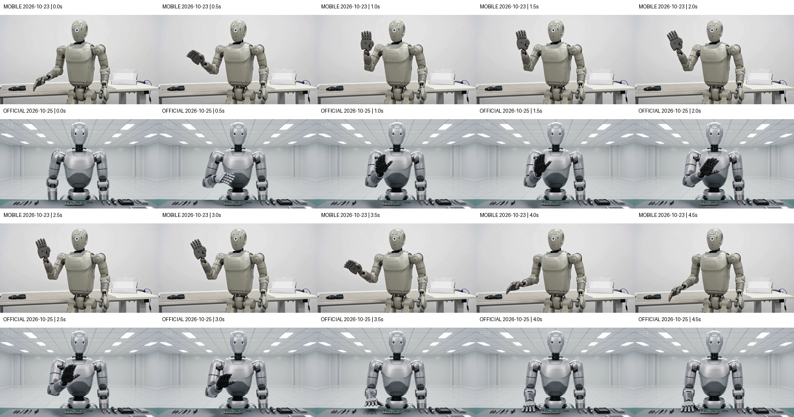
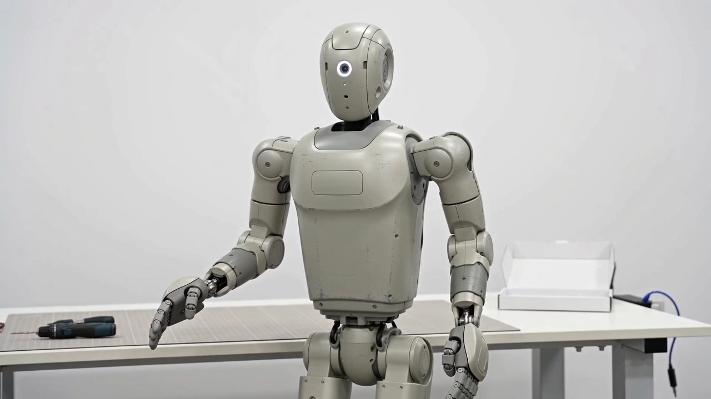

[← 返回沐仞项目与素材](../../)

## 先看结果

两边均成功生成可解码的视频，主要的抬手、挥动和放下动作均可见。本地语音转写均识别出“测试完成，运行正常”。**官方在“右手放回桌面”这一具体指令上完成得更明确；移动侧本次等待时间较短。**

## 出片速度与时间

这里比较的是**从提交到首次观察成功的等待时间**。两次都生成5秒视频；下表的分钟数是等候时长，不是成片长度。

| 记录 | 移动供应商 | 即梦官方 Seedance 2.0 |
|---|---|---|
| 测试日期 | 2026-10-23 | 2026-10-25 |
| 提交时间（北京时间） | 12:48:56.851 | 15:14:16.760 |
| 首次观察成功（北京时间） | 12:51:41.544 | 15:21:08.136 |
| **提交至首次观察成功** | **164.69秒，约2分45秒** | **411.38秒，约6分51秒** |
| 成片长度 | 约5.06秒 | 约5.09秒 |
| 模型纯推理时间 | 未取得 | 未取得 |

本次移动侧少等待 **246.68秒，约4分07秒**；官方的观测等待时间约为移动侧的 **2.50倍**。这些是这两次任务的实测记录，不代表两渠道的长期平均速度。

两次测试日期、队列负载和观察方式不同，等待时间包含排队、处理和轮询延迟，**无法据此说模型纯生成速度快2.50倍**。移动侧接口约2.68秒就返回任务ID，这只是任务创建响应；供应商任务的创建至更新时间间隔为156秒，也无法从中拆出纯推理时间。

[下载计时依据与媒体哈希](data/timing-2026-10-25.json)

## 两条原片

### 移动供应商 · 10月23日

<video controls playsinline preload="metadata" style="width:100%;max-width:800px" src="media/mobile-seedance2-20261023.mp4"></video>

[下载移动侧视频](media/mobile-seedance2-20261023.mp4){download="mobile-seedance2-20261023.mp4"}

### 即梦官方 · 10月25日

<video controls playsinline preload="metadata" style="width:100%;max-width:800px" src="media/official-seedance2-20261025.mp4"></video>

[下载官方视频](media/official-seedance2-20261025.mp4){download="official-seedance2-20261025.mp4"}

## 画面与台词

| 检查项 | 移动供应商 | 官方 |
|---|---|---|
| 主要动作 | 可见抬右手、挥动、放下 | 可见抬右手、挥动、放下 |
| “放回桌面” | 4.5秒右手下垂于身体前方，未显示明确落桌 | 4.5秒右手平放桌面，完成更明确 |
| 主体与场景 | 抽帧中保持一致，未见明显切镜或额外人物 | 抽帧中保持一致，未见明显切镜或额外人物 |
| 维修台呈现 | 工作台主要在机器人身后 | 工作台在前景，工具和元件更突出 |
| 指定台词 | 本地ASR：“测试完成运行正常。” | 同一ASR：“测试完成运行正常” |
| 字幕、标识 | 抽帧未见台词字幕或类似平台角标 | 抽帧未见台词字幕；左上有“AI生成”角标 |
| 媒体文件 | 1280×720，完整解码通过 | 1280×720，完整解码通过 |

每0.5秒抽1帧，各10帧；另查看双方4.5秒的原尺寸画面。每组上排移动、下排官方：

{fig-alt="相同时间的移动供应商与官方抽帧对照"}

### 片末4.5秒：落桌差别

移动侧：

{fig-alt="移动侧4.5秒右手下垂于身体前方，未明确落桌"}

官方：

{fig-alt="官方4.5秒右手平放在工作台上"}

## 参数与判断边界

相同提示词，文生视频，无上传参考素材。移动侧请求模型字段为`doubao-seedance-2.0`；官方选择“即梦 Seedance 2.0 VIP”标准版，未选择Fast或mini。共同参数为720p、16:9、5秒，每边1条；未对齐随机种子。

> 写实风格，5秒单镜头，固定机位，明亮的维修工作台前，一个浅灰色维修机器人面对镜头。机器人先抬起右手，缓慢挥手一次，然后将右手放回桌面。全程保持同一个机器人、同一张工作台，无切镜、无额外人物、无字幕。清晰自然的中文男声说：测试完成，运行正常。背景安静。

**本轮说明两侧接入和基本交付均已跑通，并发现了具体动作执行差别。** 各一条样本不能判断长期稳定性、并发能力、平均速度或整体质量差异，也不能证明供应商的真实上游权重与官方相同。另一家供应商此前测的是Seedance 2.5，不混入本轮2.0结果。

语音用同一本地Whisper large-v3-turbo转写，只核对词句，未评定人工听感、音色自然度或口型同步。抽帧检查不等于逐帧运动审查，未严格判定“只挥手一次”和所有手部接触细节。

本次官方仅追加生成1条，实扣70即梦积分；移动侧控制台显示费用5.0094，但结算币种尚未核实。两平台单位不同，不做价格倍数比较。

[下载报告、两条原片和抽帧完整包](https://xanthiawang.github.io/fathompeak/materials/seedance-comparison/downloads/seedance-comparison-20261025.zip)

<small>报告更新：2026-10-25。仅发布测试结果及生成媒体。</small>
